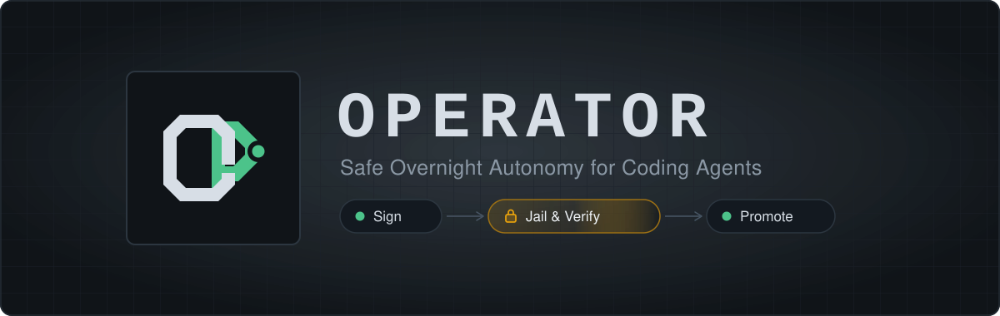
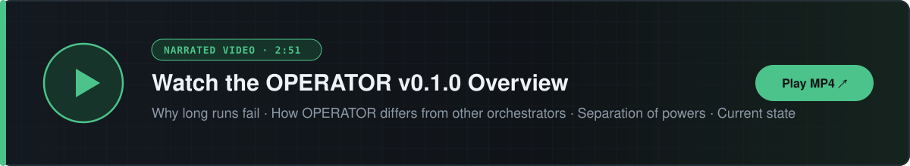
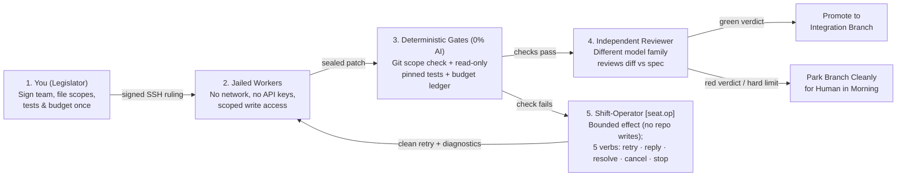

<p align="center">
  
</p>

<p align="center">
  <a href="https://github.com/0xOPER/operator/actions/workflows/ci.yml"></a>
  <a href="https://github.com/0xOPER/operator/actions/workflows/codeql.yml"></a>
  <a href="LICENSE"></a>
  
  
  
  
</p>

<p align="center">
  <strong>Run coding agents for 8 hours while you sleep—without babysitting the terminal, and without waking up to faked tests, ruined branches, or a $200 bill for broken code.</strong>
</p>

<p align="center">
  A Linux CLI harness (Python 3.11+ and bash) that runs Claude Code, Codex, OpenCode, and ZCode unattended inside <code>bubblewrap</code> jails (macOS via Docker).
</p>

<p align="center">
  <a href="#watch-the-overview">Video Overview</a> ·
  <a href="#try-it-in-60-seconds">Try It in 60 Seconds</a> ·
  <a href="#why-not-just-use-another-agent-orchestrator">Why Not Other Orchestrators?</a> ·
  <a href="#how-operator-works-separation-of-powers">How It Works</a> ·
  <a href="docs/quickstart.md">Quickstart</a> ·
  <a href="LIMITATIONS">Limitations</a>
</p>

<a id="watch-the-overview"></a>
<p align="center">
  <a href="https://github.com/0xOPER/operator/releases/download/v0.1.0/operator-overview-v0.1.0.mp4">
    
  </a>
</p>

---

Right now, "autonomous coding" is mostly an illusion. Either you keep permissions on and you are stuck babysitting your terminal clicking **Approve** and pasting error logs every 10 minutes—or you run agents in a `while true` YOLO loop overnight, and by Step 3 the agent hits a hard bug, weakens a test to get a green checkmark, and spends the next 6 hours and $200 building garbage on top of broken code.

**OPERATOR** replaces the human babysitter on long, multi-step runs. You sign the task plan, file boundaries, and budget once before you go to sleep. Then a bounded AI shift-operator (`[seat.op]`) runs the assembly line—routing retries, passing structured failure diagnostics to fresh workers, and keeping tasks moving—without ever having the power to touch code, weaken a test, or override a failed security or review gate.

> *"People think sandboxes and strict verification are the opposite of autonomy. They're actually the prerequisite for autonomy—you can only take the human out of a 10-hour loop if neither the coder AI nor the manager AI is physically capable of lying about 'done.'"*

---

## Why Long Runs Fail Today

Every builder who has tried leaving coding agents running unattended hits the same two walls:

1. **Compounding Fake Progress**
   On a 1-step demo, a 10% chance of an agent faking a test pass is annoying. On a 10-step task chain, a single fake green at Step 2 silently poisons Steps 3 through 10. Without tamper-sealed checks at every step, long runs quietly drift off a cliff.
2. **The "God-Mode Manager" Trap**
   Most multi-agent frameworks try to remove the human by putting a "Supervisor LLM" in charge with full repo access. When a worker gets stuck at 2 AM, the Supervisor LLM gets frustrated (or prompt-injected) and "helps" by lowering the bar, editing the test, or rubber-stamping bad code just to finish the job.

---

## Why Not Just Use Another Agent Orchestrator?

Most tools in the coding-agent ecosystem optimize for **speed, parallel branches, or compute isolation**—not for proving that a multi-step overnight run stayed honest. Comparing the five common architectural approaches:

| Approach | Key Isolation | Tamper-Sealed Tests | Zero-AI Gates | Wraps Any Commercial CLI | Primary Weakness on Overnight Runs |
| :--- | :---: | :---: | :---: | :---: | :--- |
| **Solo Coding CLIs & `while true` Loops** | ✗ | ✗ | ✗ | ✓ | API keys live inside the CLI process; the agent can edit repo tests or `pytest.ini`/`conftest.py`; internal permission flags drift across CLI releases. |
| **Parallel Git-Worktree & Swarm Runners** | ✗ | ✗ | ✗ | ✓ | Great for launching 5–30 parallel branches, but workers typically share your local UID, `.git` store, and raw host API keys—and trust self-reported test exits. |
| **Supervisor-LLM Multi-Agent Frameworks** | ◐ | ✗ | ✗ | ◐ | Puts a prompt-injectable manager model in charge of approving or fixing stuck tasks; under long context or hostile repo text, the supervisor softens checks or rubber-stamps broken diffs. |
| **Container & Cloud MicroVM Sandboxes** | ◐ | ✗ | ◐ | ✓ | Strong machine isolation, but **verification-blind**: an agent never needs to leave the sandbox to delete assertions, skip tests, or plant repo hooks/configs that run after handoff. |
| **In-Process Policy & Guardrail Middleware** | ◐ | ✗ | ✓ | ✗ | Formal capability/flow wrappers require instrumenting a custom Python planner loop, so they cannot wrap closed-source commercial CLIs and do not grade code truth. |
| **OPERATOR (`v0.1.0`)** | **✓** | **✓** | **✓** | **✓** | **Separates rules, jailed execution, tamper-sealed checks, cross-family review, and bounded `[seat.op]` retries.** *(Trade-off at `v0.1.0`: sequential dispatch `max_parallel = 1` today; parallel workers come next.)* |

*Legend: **✓** enforced deterministically · **◐** partial or optional · **✗** not enforced.*

---

## How OPERATOR Works: Separation of Powers

Think about what a human tech lead actually does during a long session—it is three completely different jobs. OPERATOR physically separates them so an AI can take over the babysitting without holding the keys to the kingdom:



### 1. You Set the Rules Once Upfront (0% AI)
You define the task graph (`contract.toml`), per-seat file write scopes and USD/context budgets (`team.toml`), and sign them once with your SSH key. After that, you walk away. No AI seat can edit the contract, widen its own file permissions, or raise its own budget.

### 2. Deterministic Host Gates Stop Broken Steps Cold (0% AI)
Before Step 2 is ever allowed to build on Step 1, host code verifies every candidate outside the worker's sandbox:
- **Linux `bubblewrap` confinement:** Each worker runs in a fresh, networkless jail over a clean 1-commit worktree—no git history, no host home directory, and no raw API keys (a host-side broker injects credentials and meters spend against built-in rate tables and per-attempt caps). Inside the jail, wrapped CLIs run with their own internal guardrails relaxed or disabled (such as `--sandbox danger-full-access` or `--mode yolo`) because the OS jail, broker, and Git import gate—not CLI flags—are the control boundary.
- **Strict file-scope gate:** Any edit outside a seat's declared `write` globs is rejected before import.
- **Tamper-sealed test verification:** Tests run in a fresh clean-room jail against the pinned base commit with test files and root runner configs (`pytest.ini`, `pyproject.toml`, `conftest.py`, etc.) mounted read-only, plus a `pytest-guard` wrapper checking test collection and execution receipts.
- **Independent cross-family review:** Only after automated checks pass does a reviewer seat from a **different model family** (enforced unless waived via `--waive same-family-review`) run in a read-only turn over the diff, contract receipts, and the worker's fenced self-report—so broken candidates burn `$0` in review spend.

### 3. `[seat.op]` Replaces the Human Babysitter (Bounded AI Executive)
Normally, when a worker fails a test on Attempt 1, a human has to read the log and nudge it. In unattended runs, `[seat.op]` handles that loop automatically:
- Its **effect is strictly bounded by host code**: it runs with empty repo write grants, its attempts are never sealed or promoted, and it receives no raw API keys.
- The engine reads only its directive JSON (`report.json`) and accepts **5 whitelisted verbs** (at most 8 actions per turn): `retry`, `reply`, `resolve`, `cancel`, `stop`.
- When a worker fails a legitimate test, `op` triggers a clean retry and injects structured failure diagnostics from the prior attempt so the fresh worker doesn't wake up with amnesia and repeat the same mistake.
- When a run hits a real red line—budget ceiling, retry cap, security/scope refusal, or a reviewer rejection—host code physically blocks `op` from clicking `resolve` (or retrying `review_red`) and parks that branch cleanly for you in the morning.

---

## Supported Coding CLIs

OPERATOR wraps the coding CLIs you already use—no proprietary agent SDK required. Because CLI hook channels and flags vary by vendor, external confinement (`bubblewrap`, broker, Git import gate) enforces boundaries uniformly across all adapters:

| Adapter | CLI | Tested Version | Tool Fencing | CI Conformance | Notes |
| :--- | :--- | :--- | :--- | :---: | :--- |
| `claude-code` | Claude Code (`claude`) | `2.1.318` | `hooked` (`PostToolUse`) | ✓ | Supports `[seat.op]` (`report_mount`) |
| `codex` | OpenAI Codex CLI (`codex`) | `0.166.0` | `unfenced` | ✓ | Headless turn; no `report_mount` |
| `opencode` | OpenCode (`opencode`) | `1.19.5` | `unfenced` | ✓ | Multi-provider; supports `[seat.op]` (`report_mount`) |
| `zcode` | ZCode (`zcode`) | `0.17.1` | `hooked` (`PostToolUse`) | Experimental | `tested_classes = ["write"]`; not run in CI |
| `stub` | Built-in offline stub | built-in | `unfenced` | ✓ | Zero API keys; driven by `plans/<task>.json` |

---

## Try It in 60 Seconds

No API keys needed. The built-in demo runs offline in under a minute using stub seats, exercises sealed checks and jail refusals, and prints a one-line summary (cleaning up its temp directory unless `--keep` is passed; run `scripts/run-first-level-selftests.sh` for the full live-jail tick/review ladder).

**Requirements:**
- **Linux (native, recommended):** Python 3.11+, `git`, `bubblewrap` (`bwrap`), `pytest`.
  *(On Ubuntu 24.04+, allow unprivileged user namespaces via an AppArmor profile for `bwrap` or `sudo sysctl -w kernel.apparmor_restrict_unprivileged_userns=0`.)*
- **macOS:** Docker Desktop, Colima, or OrbStack using the included Linux container wrapper (`scripts/docker-operator.sh`).

### Linux (Native)

```bash
git clone https://github.com/0xOPER/operator.git
cd operator

# Check your environment (what's installed, what's missing, next step)
bin/operator.sh doctor

# Run the full offline demo in under a minute
bin/operator.sh demo run

# Keep the demo state and inspect the read-only HTML status panel
bin/operator.sh demo run --keep demo-keep
OPERATOR_HOME=demo-keep/home bin/operator.sh panel render --run demo-run
```

### macOS (via Linux Container Wrapper)

```bash
git clone https://github.com/0xOPER/operator.git
cd operator

# Builds the Linux + bubblewrap image once and runs `demo run`
scripts/docker-operator.sh

# Check environment inside the container
scripts/docker-operator.sh doctor
```

---

## Running an Overnight Job

Once you have tried the demo, setting up an unattended run takes five steps (see [docs/quickstart.md](docs/quickstart.md) and [docs/authoring.md](docs/authoring.md) for the full walkthrough):

```bash
# 1. Scaffold a team + contract from a template (feature, plan, or research)
bin/operator.sh init my-job --template feature

# 2. Edit my-job/team.toml before validating:
#    - Replace `adapter = "stub"` with real CLIs from two model families (e.g. claude-code & codex)
#    - Add a [seat.op] section (role, adapter with report_mount such as claude-code/opencode, budget)
#      required by `--autonomy unattended`, and probe each CLI:
bin/operator.sh spawn preflight claude-code
bin/operator.sh spawn preflight codex
bin/operator.sh team validate my-job
bin/operator.sh contract validate my-job

# 3. Sign your plan, file scopes, and budgets once with a passphrase-protected SSH key
ssh-keygen -t ed25519 -N 'a passphrase you keep' -f ~/operator-key
bin/operator.sh init my-job --key ~/operator-key
CONTRACT_REPO=/path/to/your-repo bin/operator.sh ruling sign my-job --kind arm \
  --waive budget=advisory --key ~/operator-key

# 4. Start and run the unattended overnight loop (real API keys stay host-side in broker.py)
bin/operator.sh run start my-job --run r1 --autonomy unattended --from /path/to/your-repo
OPERATOR_ANTHROPIC_ORIGIN=https://api.example.com \
OPERATOR_ANTHROPIC_CREDENTIAL="$YOUR_ANTHROPIC_KEY" \
OPERATOR_OPENAI_ORIGIN=https://api.example.com \
OPERATOR_OPENAI_CREDENTIAL="$YOUR_OPENAI_KEY" \
  bin/operator.sh run loop my-job --run r1

# 5. In the morning: inspect the live panel or print the claims summary
bin/operator.sh panel serve --run r1         # http://127.0.0.1:8765
bin/operator.sh run report my-job --run r1
```

When a branch parks for human input or a reviewer needs your sign-off:

```bash
bin/operator.sh run approvals                # see every parked item and its exact fix command
bin/operator.sh review pack <attempt>        # inspect the fenced diff & test receipts
bin/operator.sh review verdict r1 impl --by reviewer --green --key ~/operator-key
```

---

## Built-In Verification & Honest Limits

OPERATOR tests its own boundaries continuously in CI—not just happy paths:

- **Cleanroom selftest battery:** `test/cleanroom.sh scripts/run-all-selftests.sh` runs every tool's selftest with `$HOME` hidden, network disabled, and the repo mounted read-only.
- **Guard mutation sensitivity ratchet:** `test/cleanroom.sh test/neuter.py` applies 461 single-guard fault patches one at a time against reduced selftests (`OPERATOR_AST_MUTANTS=1`) and fails CI if any patched guard leaves its suite green (`0` allowed survivors).
- **Sabotage & sandbox probes:** `test/hollow-battery-check.sh` verifies that common test-cheating tricks (skipping tests, editing `pytest.ini`/`conftest.py`, deleting assertions, symlink swaps) are caught under the sealed test overlay, while `test/conformance.sh` exercises write-scope and confinement cells against real pinned CLIs (`claude-code`, `codex`, `opencode`).
- **Offline Sigstore Rekor verification:** `scripts/verify-rekor.py --selftest` verifies the transparency-log anchor for [CLAIMS.md](CLAIMS.md) completely offline.

### What v0.1.0 Does Not Claim

We state our boundaries plainly in [LIMITATIONS](LIMITATIONS):
- **Trusted host OS user:** A process running unsandboxed as your same host user can modify local state or logs. The hash-chained `call-log.tsv` detects mid-file edits, but cannot detect rows cut off the end (tail truncation) without an external anchor; OS user isolation is the boundary.
- **Secret vs. tamper-sealed tests:** In-repo test suites are tamper-sealed, not hidden from reads; if you need completely hidden test vectors, keep them outside the git repo under the program's read-only directory.
- **Sequential dispatch at v0.1.0:** Ready tasks execute sequentially (`max_parallel = 1`) under a single run lock; parallel multi-worker dispatch is planned after v0.1.0.

---

## Documentation & Layout

| Document / Path | What's Inside |
| :--- | :--- |
| [docs/quickstart.md](docs/quickstart.md) | Step-by-step setup from clone to your first signed run |
| [docs/authoring.md](docs/authoring.md) | Writing `team.toml`, `contract.toml`, roles, and sealed checks |
| [docs/architecture.md](docs/architecture.md) | Deep dive into the three-branch design, jails, broker, and gates |
| [INTERFACES.md](INTERFACES.md) | Exact file formats, JSON schemas, and CLI contracts |
| [CLAIMS.md](CLAIMS.md) | Anchored engineering claims verified by `scripts/verify-rekor.py` |
| [LIMITATIONS](LIMITATIONS) | Full threat-model boundaries and v0.1.0 non-claims |
| [SECURITY.md](SECURITY.md) | Private vulnerability reporting and security scope |
| [CONTRIBUTING.md](CONTRIBUTING.md) | Local dev setup, ratchets, and PR checklist |

```text
bin/                  Engine tools (one script per verb; bin/operator.sh is the front door)
config/adapters/      Adapter manifests (claude-code, codex, opencode, zcode, stub)
profiles/templates/   Starter team + contract templates copied via `bin/operator.sh init` (do not edit in place)
docs/                 Quickstart, authoring, and architecture guides
scripts/              Docker wrapper, selftest runners, release lint, Rekor verifier
test/                 Cleanroom battery, guard mutation tests, sabotage & CLI conformance suites
```

---

## License

Licensed under the [Apache License 2.0](LICENSE).
